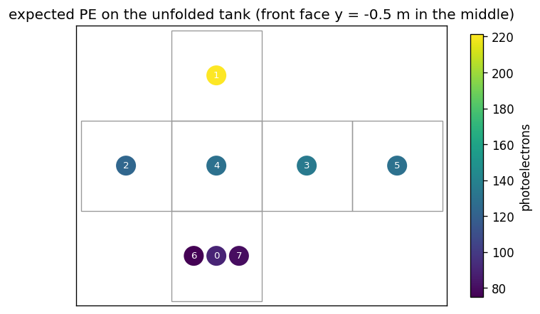
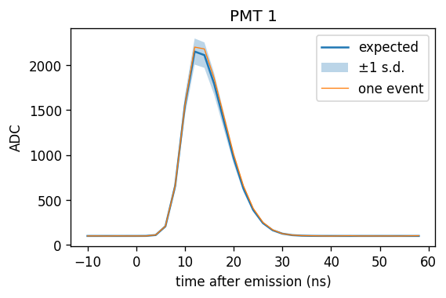

# The first hour

This tutorial takes you through lumen on the toy detector that ships with it: you simulate a light source, read what
the numbers mean, draw a hit map, take derivatives, fit a source position and a set of PMT efficiencies, and look at a
waveform. Every code block comes from `examples/first_hour.py`, which runs as it stands; the outputs shown are from
one run of it on an NVIDIA A100 (Slurm job 44124132). Your numbers can differ in the last digits on another GPU model.

Before you start, install lumen (see the [README](../../README.md)) and choose a directory for your calibrations:

```bash
export LUMEN_DETECTORS=$PWD/lumen-examples/calibrations
mkdir -p $LUMEN_DETECTORS
python examples/first_hour.py    # the whole tutorial: 193 s on an A100 with an empty cache, 105 s with a full one
```

Units are m, ns, nm and eV everywhere, as plain numbers.

## 1. The toy detector

`examples/data/example_tank.gdml` is a 1 m cube of water with 8 disc PMTs (radius 5 cm), facing inwards: one at the
centre of each face, and two more on the bottom face. Light that leaves the water is absorbed: the walls are black.
A photon that reaches a PMT face is counted, and the PMT's quantum efficiency is applied afterwards.

A GDML file says what Geant4 reads, but not which volume to simulate or what the sensors are. The **recipe** says
that. It lives in `examples/example_tank.py`:

```python
RECIPE = lumen.Recipe(
    name="example_tank",
    detector_volume="TankLV",                 # the water; light leaving it is absorbed
    wavelength_range=(300.0, 600.0),          # nm: the optics tables are read over this range
    groups=(
        SensorGroup(
            "pmt",
            rule="border_into",               # counted across the CathodeSurface border into each PMT volume
            surface="lumen:geant4", model="lumen:pmt",
            lv="PMT",                         # the logical volume of the 8 PMTs; one sensor per placement
            defaults=str(DATA / "toy_pmt.json"),          # the PMT values: QE, timing, charge, pulse
            readout={"gate": (-10.0, 60.0)},  # ns after emission
        ),
    ),
)
```

- `surface="lumen:geant4"` says how the PMT's surface behaves while photons are tracked: as stock Geant4 reads the
  GDML's `CathodeSurface`.
- `model="lumen:pmt"` is the **sensor model** applied after tracking: quantum efficiency, time spread, charge, pulse
  shape and front end.
- `defaults` names its values. `toy_pmt.json` is an illustrative set written for this tutorial, not a real PMT.
  lumen also ships value sets transcribed from WCSim and sbndcode, such as `lumen:wcte_r14374@1`.

`detector()` converts the GDML once into a **detector file** (`lumen-examples/example_tank-<digest>.lumen/`) and
loads it:

```python
det = detector()
print(det)
for i, path in enumerate(det.sensors["ids"]):
    print(f"  sensor {i}: {path}")
```
```
UserWarning: sensor values toy_pmt@1: illustrative values for the tutorial, not a real PMT
example_tank  (from example_tank.gdml)
  detector volume  TankLV; 3 volumes, 3 materials, 1 optical surfaces
  sensors          8 in 1 group(s): pmt
  calibration      nominal
  sensor 0: Tank/PMT_0/PMT
  ...
  sensor 7: Tank/PMT_7/PMT
```

The warning is lumen telling you that this PMT value set is marked `unverified`. A value set transcribed from a
reference is marked `transcribed`, and one checked against measurements `measured`.

Every value lumen uses, except the geometry, is a **parameter**, keyed by its GDML name:

```python
p0 = det.params()
for key in ("materials/Water/ABSLENGTH", "materials/Water/RINDEX", "sensors/pmt/efficiency", "sensors/pmt/tts/sigma"):
    info = p0.info(key)
    print(f"  {key:30s} unit {info.unit or '-':4s} range {info.range}  method {info.method}  "
          f"from: {p0.explain(key)}")
```
```
  materials/Water/ABSLENGTH      unit m    range (0.0, inf)  method reweight  from: detector file
  materials/Water/RINDEX         unit -    range (1.0, inf)  method moving_paths+reweight  from: detector file
  sensors/pmt/efficiency         unit -    range (0.0, 1.0)  method after_tracking  from: sensor model defaults
  sensors/pmt/tts/sigma          unit ns   range (0.5, 3.0)  method after_tracking  from: sensor model defaults
```

`info` gives each key's unit, allowed range and **gradient method**: how lumen differentiates it. `explain` says where
the value came from: the detector file, the sensor model's defaults, or a calibration.

## 2. Simulate, and what the numbers mean

A point source 10 cm above the centre emits 2 × 10^5 photons at 400 nm in all directions. lumen traces 2^18 Monte
Carlo photons for it:

```python
src = lumen.sources.Point(position=(0.0, 0.0, 0.1), lam=400.0, n_photons=2e5, time=0.0)
light = lumen.simulate(det, src, samples=2**18, seed=0)
pe = lumen.readout.pe(light, p0)
```
```
 id  arrivals   error    mean time (ns)   expected PE
  0    364.38   17.72        2.617           89.3
  1    903.11   31.21        1.699          221.3
  2    502.45   17.90        2.204          123.1
  3    550.74   18.07        2.202          134.9
  4    526.59   15.65        2.205          129.0
  5    526.60   13.17        2.201          129.0
  6    306.04   22.27        2.850           75.0
  7    325.60   13.16        2.844           79.8
health (photons): {'lost': 0.0, 'abandoned': 0.0, 'escaped': 0.0, 'late': 0.0, 'truncated': 0.0, 'n_truncated': 0.0, 'stuck': 0.0}
```

| Output | Meaning | Unit |
|---|---|---|
| `light.arrivals` (8,) | expected photons the counting rule counts at each PMT, before quantum efficiency | photons |
| `light.arrivals_error` (8,) | the Monte Carlo standard error, from the spread of 16 independent replicas | photons |
| `light.mean_arrival_time` (8,) | the arrivals-weighted mean time of arrival after emission, before the PMT's time spread | ns |
| `lumen.readout.pe(light, p0)` (8,) | expected photoelectrons: arrivals × QE × efficiency (× collection efficiency, if the value set has one) | photoelectrons |
| `light.health` | photons that ended for a reason other than absorption or detection | photons |

(This run was made before the 0.1 naming pass, which renames the health key `late` to `retired`.)

Read the table as physics:

- PMT 1, on the top face, is closest to the source (0.37 m to its face) and sees the most light; PMTs 0, 6 and 7 on
  the bottom face see the least. PMTs 2 to 5 are at the same distance from the source and agree within about two
  standard errors.
- The mean arrival times are the path lengths divided by the group velocity of light in water: 0.37 m at about
  0.22 m/ns gives the 1.7 ns of PMT 1.
- PE is about a quarter of the arrivals: `toy_pmt` has a quantum efficiency of about 0.24 at 400 nm.
- `samples` is the effort and `n_photons` the physics. Doubling `n_photons` doubles every output; doubling `samples`
  shrinks the errors by √2.
- One call simulates one event. For several sources, call `simulate` in a loop: the photon loop compiles once per
  detector, and later calls reuse it.
- Health: nothing was lost, abandoned, truncated or retired here. Photons absorbed in the water or on the black
  walls are not part of health; that is ordinary physics. Non-zero health on your own detector points at the
  geometry; see the [errors](../reference/errors.md) page.

**Choosing the photon count.** The error falls as 1/√samples. Run once at 2^16, read the relative error r0 of the
sensor you care about, then use `samples = 2**16 * (r0 / target)**2`:

```python
quick = lumen.simulate(det, src, samples=2**16, seed=0)
r0 = float(quick.arrivals_error[1] / quick.arrivals[1])
target = 0.002
print(f"PMT 1: relative error {r0:.4f} at 2**16 samples; for {target} use about {int(2**16 * (r0 / target) ** 2):,}")
```
```
PMT 1: relative error 0.0729 at 2**16 samples; for 0.002 use about 86,969,726
```

The error itself comes from 16 replicas, so it is known to about 18 %; use `replicas=64` for about 9 %. Keep `seed`
fixed inside anything you differentiate or fit, so that every call uses the same random numbers.

## 3. A hit map

lumen 0.1 has no plotting module and no public table of sensor positions yet. `examples/example_tank.py` reads the
PMT centres with `sensor_positions(det)`, and the script draws the expected PE on the unfolded tank with matplotlib:

```python
xyz = sensor_positions(det)          # (8, 3) m, in sensor order
uv = unfold(xyz)                     # 2-D positions on the unfolded cube (examples/first_hour.py)
plt.scatter(uv[:, 0], uv[:, 1], c=np.asarray(pe), s=250)
```



## 4. Derivatives and a fit

### The source position

lumen differentiates with respect to where the light starts by moving the light paths with the source while their
random numbers stay fixed (the **moving-source method**). It costs more than a plain run, so you ask for it: `wrt=`
lists what a call differentiates.

```python
def expected_pe_at(z, seed=0):
    s = lumen.sources.Point(position=jnp.stack([0.0, 0.0, z]), lam=400.0, n_photons=2e5)
    light = lumen.simulate(det, s, samples=2**18, seed=seed, wrt=["source/position"])
    return lumen.readout.pe(light, p0)

mu, dmu = jax.jvp(expected_pe_at, (jnp.float32(0.1),), (jnp.float32(1.0),))     # value and d/dz
```
```
 id   PE     dPE/dz (1/m)
  0     89.3       -313.4
  1    221.3       1186.5
  2    123.1       -112.4
  3    134.9        -56.0
  4    129.0       -117.8
  5    129.0       -120.4
  6     75.0       -225.0
  7     79.8       -223.5
```

Moving the source up (towards PMT 1) brightens PMT 1 and dims the others. Without `wrt=["source/position"]` the
derivative is not taken; with a beam (`Point(direction=...)`) it raises `GradientNotAvailable`, because the photons'
directions are not drawn from a density.

Check a derivative against a finite difference before you rely on it. The script compares them on the same random
numbers, for 8 seeds (the errors are the spread over the seeds):

```
PMT 0: derivative   -324.6 +-   4.7   finite difference   -342.8 +-  11.4   (1/m, 8 seeds)
PMT 1: derivative   1199.4 +-  12.2   finite difference   1141.4 +-  28.0   (1/m, 8 seeds)
```

Here the derivative and the finite difference agree within two standard errors (1.5 for PMT 0, 1.9 for PMT 1): this
comparison does not resolve a difference below about 5 %. The moving-source method has known limits: the shadow edge
between a source and an object close to it, light focused behind a refracting PMT window, and sources a few cm from a
reflector. They are listed in [known limits](../explanation/known-limits.md).

### A fit: the source height

Simulate one event with the source at z = 0.1 m, then find z from the PE alone, by Fisher scoring on the Poisson
likelihood. Each step uses the value and the derivative from one `jax.jvp` call:

```python
truth = lumen.sources.Point(position=(0.0, 0.0, 0.1), lam=400.0, n_photons=2e5)
event = lumen.readout.sample(lumen.simulate(det, truth, samples=2**20, seed=7), p0, seed=1)
n_obs = jnp.asarray(event.pe, jnp.float32)

z = jnp.float32(0.0)
for it in range(5):
    mu, dmu = jax.jvp(expected_pe_at, (z,), (jnp.float32(1.0),))
    z = z + jnp.sum((n_obs - mu) * dmu / mu) / jnp.sum(dmu**2 / mu)
sigma = 1.0 / jnp.sqrt(jnp.sum(dmu**2 / mu))
```
```
observed PE: [98, 234, 124, 123, 132, 135, 70, 74]
  iteration 0: z = +0.11595 m
  iteration 1: z = +0.11032 m
  iteration 2: z = +0.10970 m
  iteration 3: z = +0.10929 m
  iteration 4: z = +0.10888 m
fitted z = +0.1089 +- 0.0102 m (truth +0.1000)
```

`lumen.readout.sample` draws one random event (PE counts, hits and waveforms) from the expected light. It is not
differentiable; the expectation is. The fit uses its own seed (0), not the one that made the data (7).

### PMT values: derivatives after tracking, and a calibration

The PMT values (efficiency, QE, timing, gain) act after the photons are traced, so their derivatives are plain JAX
on the readout and cost almost nothing. `Params` is a JAX pytree, so `jax.grad` of a scalar returns a `Params` of
derivatives:

```python
KEY = "sensors/pmt/efficiency"
true_eff = jnp.asarray([0.97, 0.92, 1.0, 0.88, 0.95, 0.9, 0.85, 0.99], jnp.float32)
n_events = 20                                             # 20 flashes of the same source, summed per PMT
truth_p = p0.set(KEY, true_eff)
data = sum(lumen.readout.sample(light, truth_p, seed=100 + k).pe for k in range(n_events))

def nll(p):
    m = n_events * lumen.readout.pe(light, p)
    return jnp.sum(m - data * jnp.log(m))

g = jax.grad(nll)(p0)                    # g[KEY]: dNLL/d efficiency for each PMT
```

The expected PE is proportional to the efficiency, so the maximum-likelihood efficiency is data / expected:

```python
mu1 = n_events * np.asarray(lumen.readout.pe(light, p0), np.float64)        # at efficiency 1
eff = np.clip(np.asarray(data) / mu1, 0.0, 1.0)
```
```
dNLL/d efficiency at 1: [32.5, 311.2, -39.0, 191.6, 136.3, 194.3, 207.6, 27.5]
fitted efficiency: [0.982, 0.93, 1.0, 0.929, 0.947, 0.925, 0.862, 0.983]
its error:         [0.023, 0.014, 0.02, 0.019, 0.019, 0.019, 0.024, 0.025]
true efficiency:   [0.97, 0.92, 1.0, 0.88, 0.95, 0.9, 0.85, 0.99]
```

The fitted efficiencies agree with the true ones within three statistical errors (√data / expected); the largest
deviation, PMT 3, is 2.6 errors. PMT 2's true efficiency is 1, and the fit is clipped at the top of the allowed range.

A **calibration** saves fitted values by GDML name, without touching the detector file:

```python
det.save_calibration(p0.set(KEY, eff), "eff_fit", note="PMT efficiencies from 20 flashes")  # eff_fit.params.json
det2 = detector(calibration="eff_fit")                    # the detector file is unchanged
det2.params().explain(KEY)                                # 'calibration eff_fit'
```

It is written to the first directory on `LUMEN_DETECTORS` (or the `directory` you give), with only the values that
differ from the detector's and the detector file's digest: loading it on another detector file raises
`CalibrationMismatch`.

### Optical values

Absorption lengths, scattering lengths and reflectivities have the gradient method `reweight`: photons are drawn at
reference values and weighted by live / reference probabilities, and the
[validation report](../validation/report.md) checks these derivatives against finite differences on the five public
detectors. Take them through `simulate` like any other: trace the value (here a factor on it) and name the key in
`wrt`:

```python
KEY_A = "materials/Water/ABSLENGTH"
def total_pe(s):
    p = p0.scale(KEY_A, s)                                 # every knot of the table times s
    return lumen.readout.pe(lumen.simulate(det, src, p, samples=2**18, seed=0, wrt=[KEY_A]), p).sum()
value, slope = jax.jvp(total_pe, (1.0,), (1.0,))           # d(total PE) / d(scale), one run
```
```
total PE 981.35; d/d(ABSLENGTH scale): 8.8590 (finite difference 8.8931)
```

The finite difference (scale 1 ± 1/16, the same photons on both sides) agrees with the derivative to 0.4 %.

A key at an edge of its range (a reflectivity of exactly 0 or 1) gets its one-sided derivative. The refractive index
is calibrated by value only: its derivative raises `GradientNotAvailable` in 0.1.

## 5. A waveform

`toy_pmt` has a waveform readout: a pulse shape, a gain and a front end sampling every 2 ns.

```python
wf = lumen.readout.expected_waveform(light, p0)
t = wf.t0 + wf.dt * np.arange(wf.mean.shape[1])
ev = lumen.readout.sample(light, p0, seed=1)        # one event: ev.pe, ev.hits, ev.waveforms
```
```
mean (8, 35) unit ADC t0 -10.0 ns, dt 2.0 ns
PMT 1: baseline 100.00, peak 2151.6 ADC at 12.0 ns, standard deviation there 145.25
one event: PE [98, 235, 118, 129, 126, 133, 72, 75] ; waveforms (8, 35) ; hits 986
```

`wf.mean` is the expected baseline plus pulses, per PMT and sample; `wf.variance` is the shot noise of the
photoelectrons plus the electronic noise. The number of samples follows from the gate (−10 to 60 ns) and the
sampling step. `lumen.readout.expected_hits(light, p0)` gives the per-PMT hit probability, charge distribution and
first-hit time terms, and `lumen.readout.hits_nll` the likelihood of measured hits.



## What next

- [Your own detector](../howto/your-own-detector.md): convert your GDML, read lumen's repair warnings, calibrate,
  export and compare with Geant4.
- [Errors](../reference/errors.md): what each error means and how to fix it.
- [Known limits](../explanation/known-limits.md) and the [validation report](../validation/report.md): what lumen
  has been checked against, and what it has not.
