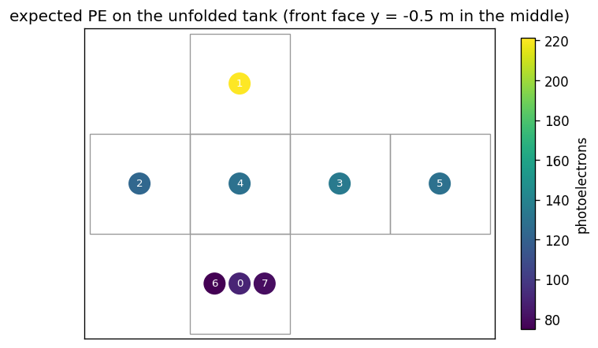
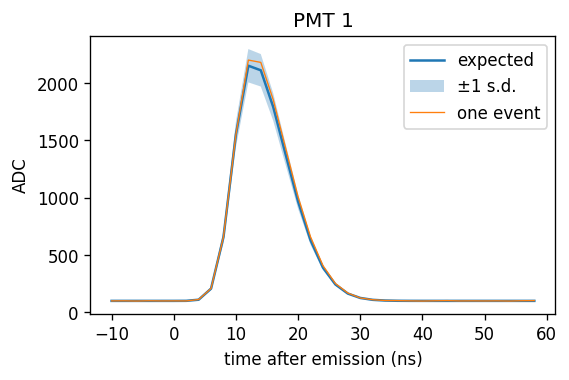

# The first hour

This tutorial takes you through lumen on the toy detector that ships with it: you simulate a light source, read what
the numbers mean, draw a hit map, take derivatives, fit a set of PMT efficiencies, and look at a
waveform. The code follows `examples/first_hour.py`, which runs as it stands; the outputs shown are from
lumen 0.1.1 on an NVIDIA A100, sections 2 and 4's optical value from lumen 0.2 on an NVIDIA RTX 2080 Ti. Your numbers can differ in the last digits on another GPU model.

Before you start, install lumen (see [installing lumen](../howto/install.md)) and choose a directory for your calibrations:

```bash
export LUMEN_DETECTORS=$PWD/lumen-examples/calibrations
mkdir -p $LUMEN_DETECTORS
python examples/first_hour.py    # the whole tutorial: 193 s on an A100 with an empty cache, 105 s with a full one
```

Units are m, ns, nm and eV everywhere, as plain numbers.

## 1. The toy detector

`examples/data/example_tank.gdml` is a 1 m cube of water with 8 disc PMTs (radius 5 cm), facing inwards: one at the
centre of each face, and two more on the bottom face. Light that leaves the water is absorbed: the walls are black.
A photon that reaches a PMT face is counted, and the PMT's quantum efficiency is applied afterwards.

A GDML file says what Geant4 reads, but not which volume to simulate or what the sensors are. The **recipe** says
that. It lives in `examples/example_tank.py`:

```python
RECIPE = lumen.Recipe(
    name="example_tank",
    detector_volume="TankLV",                 # the water; light leaving it is absorbed
    groups=(
        SensorGroup(
            "pmt",
            rule="border_into",               # counted across the CathodeSurface border into each PMT volume
            lv="PMT",                         # the logical volume of the 8 PMTs; one sensor per placement
            values=str(DATA / "toy_pmt.json"),            # the PMT values: QE, timing, charge, pulse
            readout={"gate": (-10.0, 60.0)},  # ns after emission
        ),
    ),
)
```

- While photons are tracked, the PMT's surface behaves as stock Geant4 reads the GDML's `CathodeSurface`.
- `values` names the PMT's **value set**, read by the sensor model after tracking: quantum efficiency, time spread,
  charge, pulse shape and front end. `toy_pmt.json` is an illustrative set written for this tutorial, not a real PMT.
  The experiments' packages ship value sets transcribed from WCSim and sbndcode, such as lumen-wc's
  `lumen_wc:wcte_r14374`.

`detector()` converts the GDML once into a **detector file** (`lumen-examples/example_tank-<digest>.lumen/`) and
loads it:

```python
det = detector()
print(det)
for i, path in enumerate(det.sensor_table().name):
    print(f"  sensor {i}: {path}")
```
```
UserWarning: sensor values toy_pmt@1: illustrative values for the tutorial, not a real PMT
example_tank  (from example_tank.gdml)
  detector volume  TankLV; 3 volumes, 3 materials, 1 optical surfaces
  sensors          8 in 1 group(s): pmt
  calibration      nominal
  sensor 0: Tank/PMT_0/PMT
  ...
  sensor 7: Tank/PMT_7/PMT
```

The warning is lumen telling you that this PMT value set is marked `unverified`. A value set transcribed from a
reference is marked `transcribed`, and one checked against measurements `measured`.

Every value lumen uses, except the geometry, is a **parameter**, keyed by its GDML name:

```python
p0 = det.params()
for key in ("materials/Water/ABSLENGTH", "materials/Water/RINDEX", "sensors/pmt/efficiency", "sensors/pmt/tts/sigma"):
    info = p0.info(key)
    print(f"  {key:30s} unit {info.unit or '-':4s} range {info.range}  method {info.method}  "
          f"from: {p0.explain(key)}")
```
```
  materials/Water/ABSLENGTH      unit m    range (0.0, inf)  method reweight  from: detector file
  materials/Water/RINDEX         unit -    range (1.0, inf)  method moving_paths+reweight  from: detector file
  sensors/pmt/efficiency         unit -    range (0.0, 1.0)  method after_tracking  from: sensor model defaults
  sensors/pmt/tts/sigma          unit ns   range (0.65, 2.6)  method after_tracking  from: sensor model defaults
```

`info` gives each key's unit, allowed range and **gradient method**: how lumen differentiates it. `explain` says where
the value came from: the detector file, the sensor model's defaults, or a calibration.

## 2. Simulate, and what the numbers mean

A point source 10 cm above the centre emits 2 × 10^5 photons at 400 nm in all directions. lumen traces 2^18 Monte
Carlo photons for it:

```python
src = lumen.sources.Point(position=(0.0, 0.0, 0.1), lam=400.0, n_photons=2e5, time=0.0)
light = lumen.simulate(det, src, samples=2**18, seed=0)
pe = lumen.readout.pe(light, p0)
```
```
 id  arrivals   error    mean time (ns)   expected PE
  0    394.54   17.22        2.613           96.7
  1    913.75   26.23        1.699          223.9
  2    547.76   20.30        2.204          134.2
  3    501.74   19.43        2.202          122.9
  4    515.31   19.69        2.208          126.3
  5    528.14   19.94        2.204          129.4
  6    320.36   15.51        2.851           78.5
  7    340.68   16.03        2.844           83.5
health (photons): {'lost': 0.0, 'abandoned': 0.0, 'escaped': 0.0, 'truncated': 0.0, 'records': 5921.0, 'records_dropped': 0.0, 'records_mismatch': 0.0, 'nonfinite': 0.0, 'invalid': 0.0}
```

| Output | Meaning | Unit |
|---|---|---|
| `light.arrivals` (8,) | expected photons the counting rule counts at each PMT, before quantum efficiency | photons |
| `light.arrivals_error` (8,) | the Monte Carlo standard error, from the spread of the photons themselves (each PMT's per-photon second moment) | photons |
| `light.mean_arrival_time` (8,) | the arrivals-weighted mean time of arrival after emission, before the PMT's time spread | ns |
| `lumen.readout.pe(light, p0)` (8,) | expected photoelectrons: arrivals × QE × efficiency (× collection efficiency, if the value set has one) | photoelectrons |
| `light.health` | photons that ended for a reason other than absorption or detection | photons |

Read the table as physics:

- PMT 1, on the top face, is closest to the source (0.37 m to its face) and sees the most light; PMTs 0, 6 and 7 on
  the bottom face see the least. PMTs 2 to 5 are at the same distance from the source and agree within about two
  standard errors.
- The mean arrival times are the path lengths divided by the group velocity of light in water: 0.37 m at about
  0.22 m/ns gives the 1.7 ns of PMT 1.
- PE is about a quarter of the arrivals: `toy_pmt` has a quantum efficiency of about 0.24 at 400 nm.
- `samples` is the effort and `n_photons` the physics. Doubling `n_photons` doubles every output; doubling `samples`
  shrinks the errors by √2.
- One call simulates one event. For several sources, call `simulate` in a loop: the photon loop compiles once per
  detector, and later calls reuse it.
- Health: nothing was lost, abandoned or truncated here. Photons absorbed in the water or on the black
  walls are not part of health; that is ordinary physics. Non-zero health on your own detector points at the
  geometry; see the [errors](../reference/errors.md) page.

**Choosing the photon count.** The error falls as 1/√samples. Run once at 2^16, read the relative error r0 of the
sensor you care about, then use `samples = 2**16 * (r0 / target)**2`:

```python
quick = lumen.simulate(det, src, samples=2**16, seed=0)
r0 = float(quick.arrivals_error[1] / quick.arrivals[1])
target = 0.002
print(f"PMT 1: relative error {r0:.4f} at 2**16 samples; for {target} use about {int(2**16 * (r0 / target) ** 2):,}")
```
```
PMT 1: relative error 0.0607 at 2**16 samples; for 0.002 use about 60,432,402
```

The error comes from the photons' own spread: for each PMT, the sum over photons of the square of what each photon
added to it (`lumen.readout.grid.moment_error`), which estimates the variance of independent photons without bias.
Keep `seed` fixed inside anything you differentiate or fit, so that every call uses the same random numbers.

**Fast and exact runs.** `simulate` runs `speed="fast"` by default: in a medium that only scatters (Rayleigh), a
photon walks its own scatterings inside a ball the geometry proves empty, without asking the geometry at each one. It
is the same estimator in law with other random numbers, not an approximation. `speed="exact"` turns it off, bit for
bit the plain loop. A run the fast walk cannot serve (a derivative on the source position, a probe diagnostic) runs exact by
itself; `light.provenance` records which level ran (`("speed", "fast")`, or `"exact (<why>)"`).

## 3. A hit map

`lumen.tools.plot` draws sensor maps of a whole detector (`display`, `event`; the `plot` extra installs matplotlib).
For this cube the script draws its own: `det.sensor_table()` gives each sensor's centre, in the order of
`light.arrivals` (`examples/example_tank.py` wraps it as `sensor_positions(det)`), and the expected PE goes on the
unfolded tank:

```python
xyz = sensor_positions(det)          # (8, 3) m, in sensor order
uv = unfold(xyz)                     # 2-D positions on the unfolded cube (examples/first_hour.py)
plt.scatter(uv[:, 0], uv[:, 1], c=np.asarray(pe), s=250)
```



## 4. Derivatives and a fit

### An optical value

Every value in the detector file is a parameter, and `jax.jvp` / `jax.grad` over it give its derivative. Absorption
lengths, scattering lengths and reflectivities have the gradient method `reweight`: photons are drawn at reference
values and weighted by live / reference probabilities. Take them through `simulate` like any other: trace the value
(here a factor on it): whatever carries a tangent is differentiated, with no declaration:

```python
KEY_A = "materials/Water/ABSLENGTH"
def total_pe(s, seed=0, reference=None):
    p = p0.scale(KEY_A, s)                                 # every knot of the table times s
    light = lumen.simulate(det, src, p, samples=2**18, seed=seed, reference=reference)
    return lumen.readout.pe(light, p).sum()
value, slope = jax.jvp(total_pe, (1.0,), (1.0,))           # d(total PE) / d(scale), one run
```
```
total PE 981.24; d/d(ABSLENGTH scale): 8.8562
```

Check a derivative against a finite difference before you rely on it. `reference=p0` makes every random choice at
the nominal values while the light is computed at the values given, so at a fixed seed the light is a smooth function
of the value and a central difference converges to the derivative of that seed:

```python
fd = (total_pe(1 + h, seed, reference=p0) - total_pe(1 - h, seed, reference=p0)) / (2 * h)
```
```
seed 0: derivative 8.8562; finite difference at h = 1/16 8.8911 (+3.9e-03), at h = 1/64 8.8574 (+1.4e-04)
seed 1: derivative 8.9260; finite difference at h = 1/16 8.9609 (+3.9e-03), at h = 1/64 8.9297 (+4.1e-04)
seed 2: derivative 8.7609; finite difference at h = 1/16 8.7949 (+3.9e-03), at h = 1/64 8.7637 (+3.2e-04)
seed 3: derivative 8.8797; finite difference at h = 1/16 8.9141 (+3.9e-03), at h = 1/64 8.8809 (+1.3e-04)
```

At h = 1/16 every seed's difference is 3.9e-3 above its derivative: the curvature of the light in the absorption
length (a central difference is off by h²/6 times the third derivative). At h = 1/64 the gap shrinks about tenfold,
to the float32 resolution of the totals (about 3e-4 of the slope here); a smaller step measures rounding, not the
derivative. The derivative differs from seed to seed by about 1 %: that is the Monte Carlo error of the slope.

A key at an edge of its range (a reflectivity of exactly 0 or 1) gets its one-sided derivative. The refractive index
is calibrated by value only: its derivative raises `GradientNotAvailable`.

The source position has no derivative in this version: a tangent on `source/position` is refused ([known
limits](../explanation/known-limits.md#derivatives-in-the-source-position)). The script shows the refusal.

### PMT values: derivatives after tracking, and a calibration

The PMT values (efficiency, QE, timing, gain) act after the photons are traced, so their derivatives are plain JAX
on the readout and cost almost nothing. `Params` is a JAX pytree, so `jax.grad` of a scalar returns a `Params` of
derivatives:

```python
KEY = "sensors/pmt/efficiency"
true_eff = jnp.asarray([0.97, 0.92, 1.0, 0.88, 0.95, 0.9, 0.85, 0.99], jnp.float32)
n_events = 20                                             # 20 flashes of the same source, summed per PMT
truth_p = p0.set(KEY, true_eff)
rng = np.random.default_rng(100)
data = rng.poisson(n_events * np.asarray(lumen.readout.pe(light, truth_p), np.float64))   # PE counts, no electronics

def nll(p):
    m = n_events * lumen.readout.pe(light, p)
    return jnp.sum(m - data * jnp.log(m))

g = jax.grad(nll)(p0)                    # g[KEY]: dNLL/d efficiency for each PMT
```

The pseudo-data are Poisson draws of the expected PE: the counts `readout.pe` describes. A sampled event's
`sample(...).pe` is not that quantity: it counts the hits after the readout chain, so it includes dark noise inside
the gate and loses the photoelectrons below the threshold and outside the gate (on a value set with a threshold, SK's,
it is about 1 % below `readout.pe`). Fitting `readout.pe` to sampled events biases the efficiency by that much; model
sampled hits with `lumen.readout.expected_hits` and `lumen.readout.hits_nll`, which include the electronics.

The expected PE is proportional to the efficiency, so the maximum-likelihood efficiency is data / expected:

```python
mu1 = n_events * np.asarray(lumen.readout.pe(light, p0), np.float64)        # at efficiency 1
eff = np.clip(np.asarray(data) / mu1, 0.0, 1.0)
```
```
dNLL/d efficiency at 1: [8.0, 394.6, -44.8, 296.9, 110.5, 244.5, 194.8, 28.6]
fitted efficiency: [0.996, 0.911, 1.0, 0.89, 0.957, 0.905, 0.87, 0.982]
its error:         [0.024, 0.014, 0.02, 0.018, 0.019, 0.019, 0.024, 0.025]
true efficiency:   [0.97, 0.92, 1.0, 0.88, 0.95, 0.9, 0.85, 0.99]
```

The fitted efficiencies agree with the true ones within two statistical errors (√data / expected); the largest
deviation, PMT 0, is 1.1 errors. PMT 2's true efficiency is 1, and the fit is clipped at the top of the allowed range.

A **calibration** saves fitted values by GDML name, without touching the detector file:

```python
det.save_calibration(p0.set(KEY, eff), "eff_fit", note="PMT efficiencies from 20 flashes")  # eff_fit.params.json
det2 = detector(calibration="eff_fit")                    # the detector file is unchanged
det2.params().explain(KEY)                                # 'calibration eff_fit'
```

It is written to the first directory on `LUMEN_DETECTORS` (or the `directory` you give), with only the values that
differ from the detector's and the detector file's digest: loading it on another detector file raises
`CalibrationMismatch`.

## 5. A waveform

`toy_pmt` has a waveform readout: a pulse shape, a gain and a front end sampling every 2 ns.

```python
wf = lumen.readout.expected_waveform(light, p0)
t = wf.t0 + wf.dt * np.arange(wf.mean.shape[1])
ev = lumen.readout.sample(light, p0, seed=1)        # one event: ev.pe, ev.hits, ev.waveforms
```
```
mean (8, 35) unit ADC t0 -10.0 ns, dt 2.0 ns
PMT 1: baseline 100.00, peak 2151.7 ADC at 12.0 ns, standard deviation there 145.26
one event: PE [98, 237, 117, 130, 121, 133, 70, 76] ; waveforms (8, 35) ; hits 982
```

`wf.mean` is the expected baseline plus pulses, per PMT and sample; `wf.variance` is the shot noise of the
photoelectrons plus the electronic noise. The number of samples follows from the gate (−10 to 60 ns) and the
sampling step. `lumen.readout.expected_hits(light, p0)` gives the per-PMT hit probability and what the hit
likelihood needs, and `lumen.readout.hits_nll` the likelihood of every measured hit.



## What next

- [Your own detector](../howto/your-own-detector.md): convert your GDML, read what lumen refuses and repair it, calibrate,
  export and compare with Geant4.
- [Errors](../reference/errors.md): what each error means and how to fix it.
- [Known limits](../explanation/known-limits.md) and the [validation report](../validation/report.md): what lumen
  has been checked against, and what it has not.
